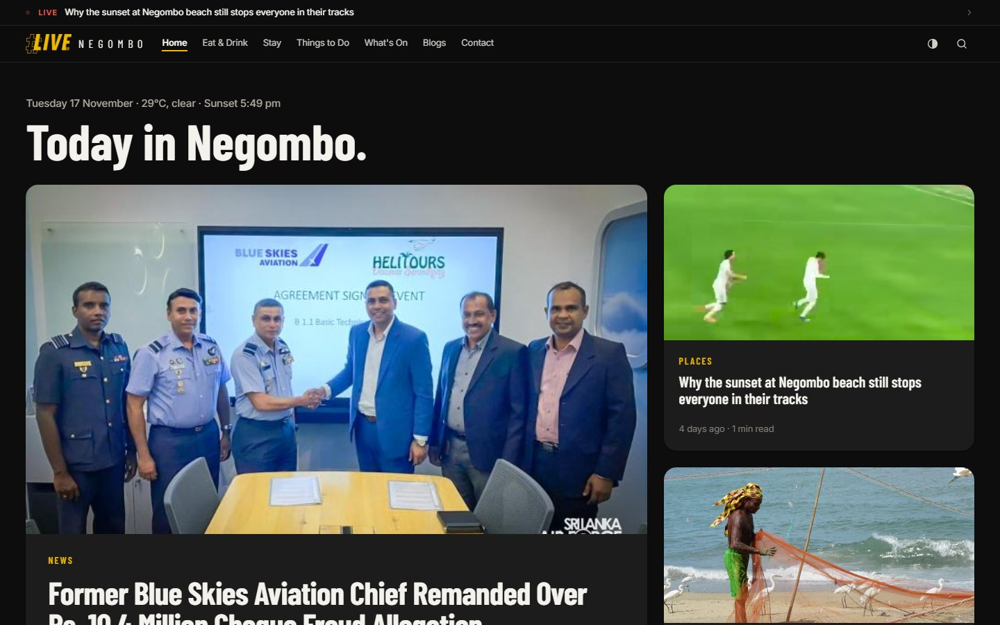
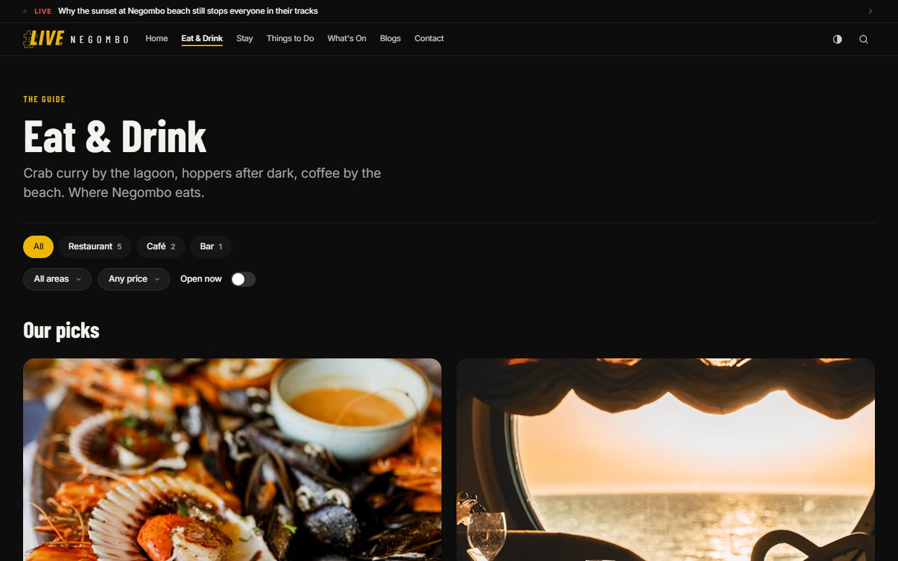
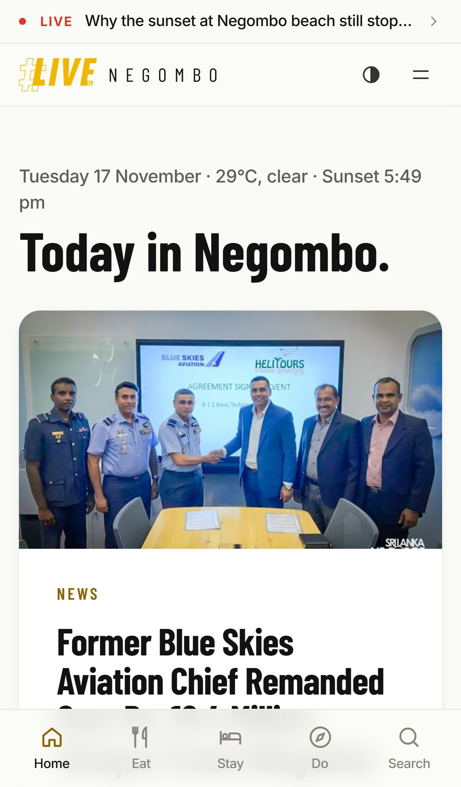

# Live Negombo

**City guide and local media platform for Negombo, Sri Lanka**

News · food · places · events · stories

**[Visit the live site](https://live-negombo.vercel.app)**

> [!NOTE]
> This is a **showcase repository**: it presents the project, not its source code. The code is private.
> Live Negombo was designed and built by **Tehan Athaudage** ([Website by TA](https://websitebyta.vercel.app)).

| | |
|---|---|
| **Type** | Client platform (a Yugen Solutions client project) |
| **My role** | Design and full-stack development |
| **Built by** | Tehan Athaudage (Tehan Gimsara), Website by TA |
| **Live** | https://live-negombo.vercel.app |

## About the project

Live Negombo is the calm, modern way to keep up with Negombo: local news, where to eat and stay, things to do, events and the town's history, with a newsroom where editors publish stories. It is the first city of the wider Live SL platform.

## What I built

| | |
|---|---|
| **Today in Negombo** | A live home page with weather, sunset time, a breaking-news ticker and the latest stories. |
| **Eat, Stay, Do** | Place guides with filters by area, price and open now. |
| **Events and blogs** | What's on in town, plus long-form stories and the people of Negombo. |
| **Newsroom admin** | Editors write articles, add places and events and upload photos. |
| **App-like on phones** | A bottom tab bar, light and dark themes and fast page loads. |
| **Search-ready** | Article and place structured data, a dynamic sitemap and Google News groundwork. |

## Screens

<table>
<tr>
<td width="50%"> <b>Eat and drink guide</b></td>
<td width="50%"> <b>Home page on a phone</b></td>
</tr>
</table>

## Tech stack

Next.js 15 · React · TypeScript · Express 5 · Prisma · PostgreSQL (Neon) · Vercel Blob · Vercel

## Want something like this?

I'm Tehan Athaudage, a freelance web designer and developer from Sri Lanka working with businesses worldwide.

[Portfolio](https://websitebyta.vercel.app) · [LinkedIn](https://www.linkedin.com/in/tehan-athaudage-663102382/) · [Instagram](https://www.instagram.com/websitebyta/) · [Facebook](https://www.facebook.com/Thalric1) · [Email](mailto:websitebyta@gmail.com) · [WhatsApp](https://wa.me/94761629355)

---

© 2026 Tehan Athaudage. Showcase only: see [NOTICE.md](NOTICE.md). Client names, logos and photos belong to their owners.
